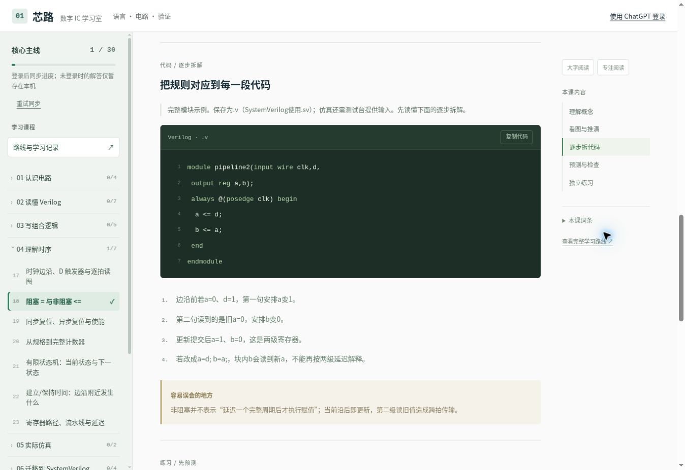
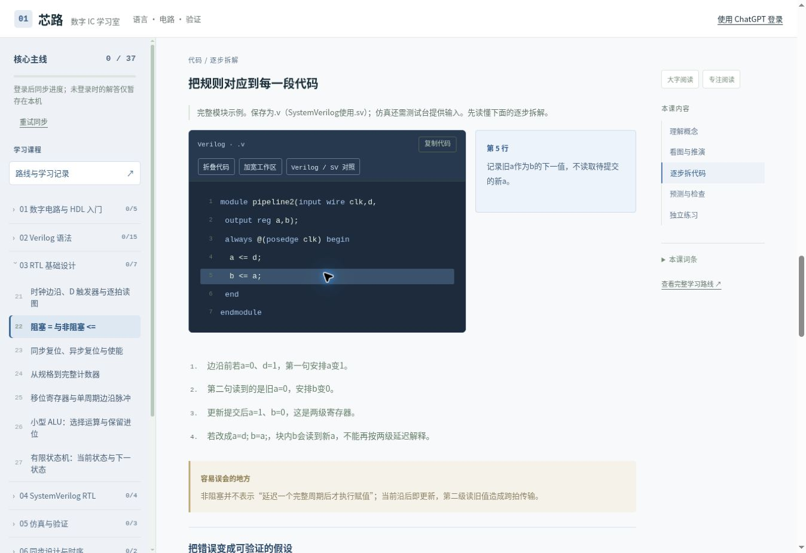
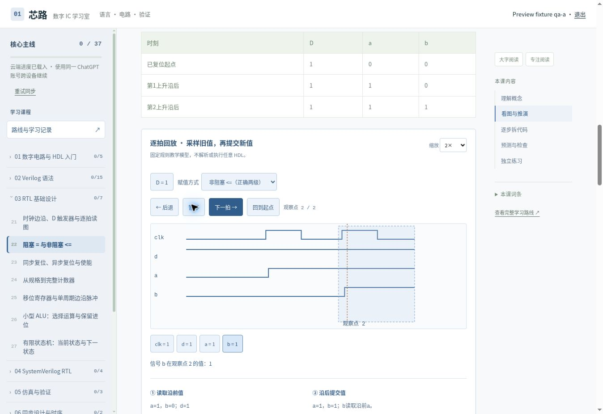
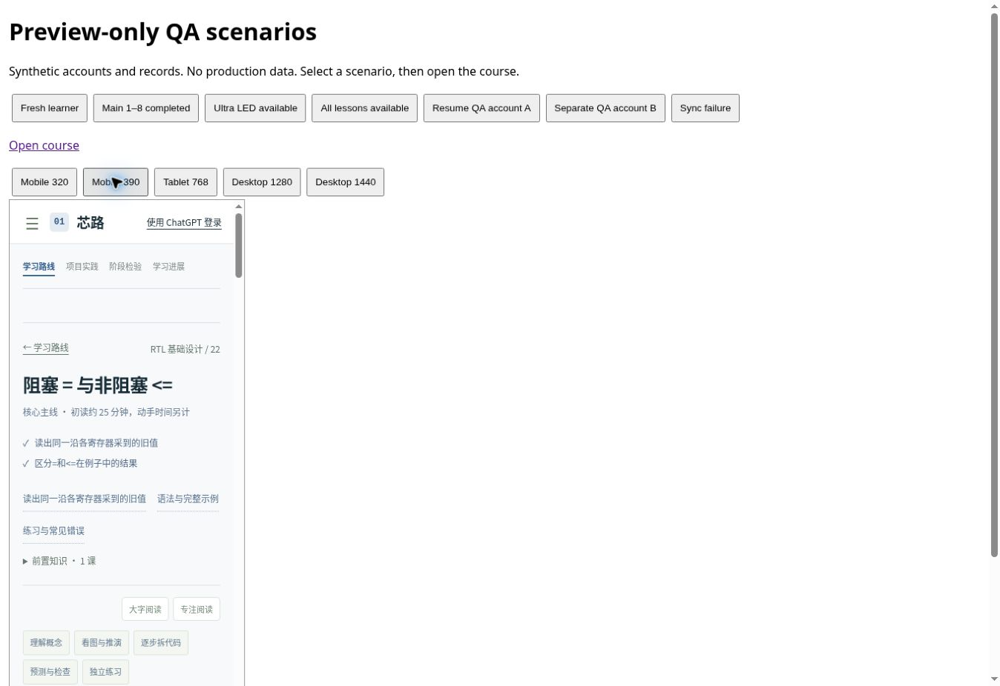

# 交付记录：交互式RTL教材 P0

本轮在 `feat/interactive-rtl-textbook` 开发，不合并main、不发布线上站点。保留现有原生JavaScript/hash路由、Worker/D1、课程ID和账号同步。GitHub的cloud目录落后于现站，因此PR同时纳入现站已有的35课语言路线基线，再叠加本轮改动；英文根目录版本保留。

## 教学问题与路线

原24课并非完全没有内容：工具、综合和验收较完整。主要断层是语言基础与高级工具混杂、语法遗漏、代码到电路缺少映射、时序不能回退观察、练习只有统一选择题/文本框。完整逐节点审计与覆盖矩阵见 [TEACHING_AUDIT.md](TEACHING_AUDIT.md)。

新路线为：数字电路与HDL入门 → Verilog语法 → RTL基础设计 → SystemVerilog RTL → 仿真与验证 → 同步设计与时序 → 综合与工程实践 → 高级选修。完整42课、前置关系与深度见 [COURSE_ROUTE.md](COURSE_ROUTE.md)。37课为核心、5课选修；原24课、FPGA、项目路线继续可访问，旧标识不变。

新增7课：锁存器与触发器区别、符号转换、casez、编译指令/宏、移位与边沿脉冲、ALU、事件调度。不是所有42课都达到同等精讲深度，本轮六个精讲为组合逻辑、DFF、阻塞/非阻塞、计数器、FSM、always_comb/always_ff。

## 实际实现

- 阶段→课程→知识点导航；每课前置链接、目标、概念、示例、语法拆解、错误提醒、练习、下一课。阶段四不依赖高级验证或UVM。
- 六课补充直观引入、硬件原理、逐行解释、错误代码/修正/验证、五类练习。强调同沿采旧值、NBA提交、使能保持、复位优先级与计数回绕。
- 代码高亮、点击或键盘选择代码行、关键词说明、复制、折叠、加宽；三课Verilog/SV对照。
- MUX、DFF、两级寄存器、计数器、FSM结构图及文本等价。固定模型回放支持前进/回退、播放/暂停、起点、信号值、缩放、横向滚动及采样/提交解释，代码行同步。
- 五类练习分别为基础理解、代码补全、独立实现、Bug修复、波形分析。封闭题自动反馈、错题回看；独立实现保存草稿并显式自查。完成要求包含所有阶梯，既有完成记录保留。
- 四级状态为未开始、学习中、已练习、已掌握；“已掌握”来自完成条件及学习者自评，不是任意RTL的正确性证明。
- 蓝灰阅读界面，桌面代码/解释并列，手机上下排布、不强制代码折行，目录抽屉、可折叠辅助导航、焦点样式、文本波形等价和减少动画偏好。
- 账号/进度未确定显示待载入，失败有重试；API超时12秒，脚本加载失败有恢复页面。旧客户端不能抹掉新课程及练习字段，CAS冲突、离线缓存与导入导出继续使用既有机制。

## 验证记录

| 检查 | 结果与边界 |
|---|---|
|Node回归|30项通过：旧24课、FPGA、项目、身份隔离、冲突/离线、迁移、旧客户端、前置依赖、教学模型、练习完成条件|
|语法Lint|34个JavaScript文件通过node --check；不是完整静态类型/无障碍审计|
|构建|npm run build通过，预览QA入口不进入正式构建|
|Python Golden|4项通过|
|教材HDL解析/展开|pyslang检查34个完整例子通过；8个明确片段不冒充完整编译单元|
|六模块功能验证|Yosys CXXRTL + C++，80周期共560个比较通过；计数器故意+2变异被检测失败|
|原工程HDL回归|tools/check-hdl.py通过：教学RTL、UART 256字节/坏停止位/假起始/复位、RAM/FIFO等|
|浏览器交互|代码折叠/语言对照、行解释、回放/回退/阻塞对照/缩放/播放暂停、错题反馈、五级练习门控、完成1/37|
|进度UI|合成账号A成功载入；503失败显示待载入且保留草稿；恢复成功；导出包含5个活动、独立草稿与完成标志，导入提示成功，刷新后1/37仍保留|
|响应式|开发iframe分别320/390/768/1280/1440px；内页clientWidth与scrollWidth一致（滚动条占15px），手机目录可打开关闭|
|链接|自动测试检查课程/前置/旧路线ID及知识点锚点；未逐一联网检查所有外部工具资料|

开发浏览器测试使用本地预览合成账号，不触碰线上用户数据。浏览器日志里有扩展发送metadata的错误，非本站脚本错误。未测试真实设备触屏、读屏软件或生产ChatGPT登录流程，不将本地合成账号等同生产端到端验收。

## 界面对比

同一非阻塞赋值课的代码区域：

| 修改前 | 修改后 |
|---|---|
|||

截图来自真实浏览器；手机图保留开发预览外框，框内为手机宽度课程。

## 技术限制与下一步

P0落地：审计、路线、导航/阅读、七项基础补缺、六课精讲、代码/波形/电路组件、分层练习、响应式、进度兼容与回归。其余课程已复用统一模板，尚未全部达到六课的精讲标准。

网页模型不是编译器，不支持任意HDL执行；没有关键词匹配冒充验证。回放起点假设状态已知为0，模型不模拟四态、物理延迟、亚稳态或完整调度区域。pyslang只证明所检示例可解析/展开，CXXRTL检查六个可综合模型，不覆盖事件仿真或STA。商业VCS/DC和板卡未运行。

P1：布尔代数/译码器的完整练习，Moore/Mealy对照、always_latch完整例题、package/interface完整RTL、多模块层次工程、setup/hold/skew/多周期专门交互、CDC及同步器适用边界、异步FIFO、UART/FIFO项目连续验收。阶段7沿用旧工具课与实践模块，尚未重写成一套完整项目教材。

P2：受限后端仿真、覆盖率驱动验证、SVA/UVM、总线/ASIC/PPA、学习薄弱项诊断。真实仿真接入应隔离任务、限制CPU/内存/时间、无网络、维护工具版本，并返回真实编译日志和测试结果。

## 运行

`npm install`，`npm test`，`npm run lint`，`npm run build`。HDL检查安装 `python -m pip install pyslang yowasp-yosys` 并提供g++，运行 `npm run check:hdl`；原工程用 `python tools/check-hdl.py`（确保yowasp-yosys位于PATH）。开发运行方式见README。
