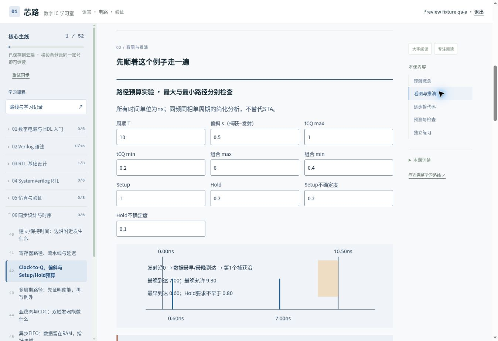

> 历史记录：此文描述v4.0发布时状态。当前评审改动见[教学修复报告](QUALITY_REPAIR_REPORT.md)，原文中的比赛入口与统一五级练习已由新版本替换。

# 完整教材发布交付

本轮在已合并P0基础上继续完善并发布原Site。原24课、FPGA/项目路线、42个语言课程ID、学习记录和D1表结构保留。

## 内容落地

56课（52主线、4选修），全部有具体原理、代码说明、错误/修正/验证及五级练习，共280个阶梯活动。原6课精讲继续保留；其他50课逐题补写。理论/工具课用情景推演，时序课用波形分析，不强行为概念问题制造假波形。

八阶段路线、逐课前置关系见[COURSE_ROUTE.md](COURSE_ROUTE.md)，原问题及修补矩阵见[TEACHING_AUDIT.md](TEACHING_AUDIT.md)，上一轮历史见[P0_IMPLEMENTATION_REPORT.md](P0_IMPLEMENTATION_REPORT.md)。

新增布尔/译码、层次/RTL task、Moore/Mealy、always_latch、偏斜、multicycle、CDC、异步FIFO原理、综合/lint、RAM、同步FIFO、UART发送、背压集成、进阶地图。package/interface提供可展开顶层，握手与接口回到主线，UVM不作前置。

## 交互与工程

- 各课语法/概念对照、行解释、折叠/复制/加宽、错误诊断与分层练习。六课保留受控逐拍回放、代码同步及Verilog/SV对照。
- Setup/Hold可移动窗口；max/min预算分别计算；偏斜正负、频率与hold关系可操作；流水线级数按理想均分假设计算；多周期显示第N捕获沿。
- CDC窄脉冲实验展示可能完全漏采；Gray指针支持前后和回绕，不伪造亚稳态波形。
- RAM、FIFO、UART与弹性寄存器有完整RTL、规格、调试/验收说明与下载包。TB自检RAM冲突、FIFO边界/回绕、RV背压、UART全部256字节位序与时长。
- 旧完成记录不清零，新增课显示待学；同步失败仍保留缓存、待载入状态与重试。未改数据库或访问范围。

## 结果

|检查|结果|
|---|---|
|Node回归|33项通过，含全56课内容、依赖、练习、旧进度/账号/CAS/离线、时序公式和下载源码一致性|
|JS Lint/构建|36份JS语法检查及正式构建通过|
|HDL解析/展开|46个完整示例通过；10个终端/说明/片段明确排除，未声称完整编译|
|下载TB|pyslang语法/展开通过；当前环境未运行Icarus事件仿真|
|原6模块|560次CXXRTL比较通过，计数+2负例被拒绝|
|新增工程4模块|12000周期、95997次CXXRTL比较通过；覆盖256个UART负载、RAM read-first、FIFO满空/回绕、RV背压；FIFO取消满保护与UART错位负例均失败|
|既有工程|原HDL回归及4项Python Golden通过|
|浏览器|56页逐一加载，均5个活动、无恢复错误页；时序公式、窗口、CDC、Gray交互实际检查|
|响应式|320/390/768/1280/1440检查；修复320下错误代码列min-width导致12px溢出，复查整页宽度一致；目录抽屉可触达|

阶段测试出现的短题目长度检查已改为非空和有效答案校验：题目质量不以字符数量判断。真正功能证据来自公式边界与RTL回归，不用文本长度代替功能测试。

## 界面

此前基线对比截图仍保留于review目录。截图为真实浏览器预览，未使用静态mockup。

## 运行与限制

`npm test`、`npm run lint`、`npm run build`。`npm run check:hdl`需要pyslang、yowasp-yosys、g++。`python tools/package-rtl-lab.py`从教材标准源码生成确定性练习包。

网页仍不执行任意HDL。开放代码由学习者对照规格自查，真实仿真需本机工具；CXXRTL验证二态可综合功能，不替代四态事件仿真、SVA求解或STA。物理延迟、亚稳态、库/布局、商业VCS/DC、读屏和真实板卡未验收。异步FIFO是原理课，完整双时钟实现使用验证IP；UVM/总线/ASIC/PPA是进阶地图而非工业签核能力证明。

上线保留原公开范围，使用现有D1。未来扩展为安全后端仿真、完整UVM项目和真实板级/工艺实验，不在当前环境伪造这些能力。
