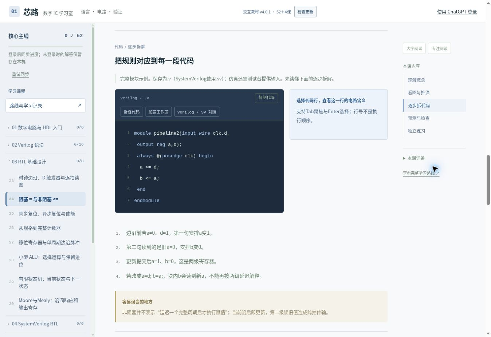
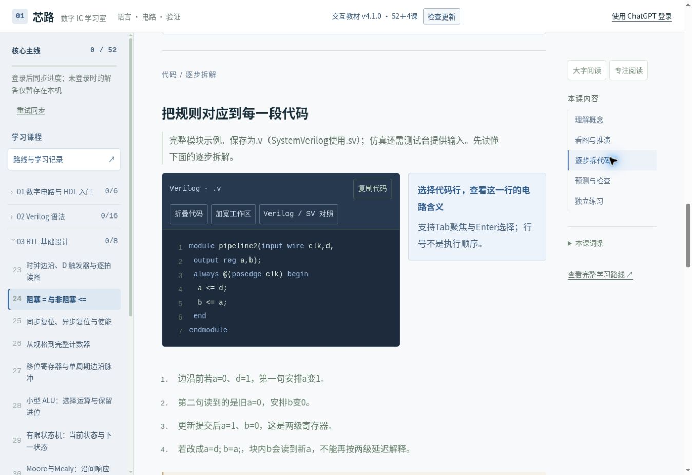

# 教学质量修复与FPGA全流程重构 · 评审报告

本次只在feat/teaching-fpga-workflow分支交付，不合并main，不部署正式网站。保留原生JavaScript/hash路由、Worker/D1与现有课程标识。

## 审计结论与实际改动

先完成[56课问题矩阵](LESSON_QUALITY_MATRIX.md)，再修改正文、练习和界面。矩阵后半部分逐课记录概念回链和题目衔接；这部分来自阅读正文、示例、错误片段和题目的语义审查，自动测试只能验证结构与引用，不能证明概念已经讲清。

原问题包括9–12px说明、填空/Bug题实为选择题、14课重复通用工程证据问题、初学课超前考语法、接口课超前考协议、同名FIFO混用采样相位，以及字符串替换式厂商“适配”。修复后：

- 56课重写问题引入和推导，保留较深入原理为可展开阅读；为基础、物理概念选择更合适题型，不强凑五级。
- 255项活动：102选择、44真实填空、32固定代码修复、18短答/波形、40独立实现、19分析任务。与原280项相比减少无意义活动。
- 14道重复通用主问题全部替换；另修订3道相关主问题，共17课采用新检查版本。
- 每个独立任务补充相应输入、接口或规格、测试条件、参考及自查；旧选择题保留作答历史，不能冒充新版代码任务通过。
- storage课只辨认电平、边沿、透明和保持，不考if/else；DFF和NBA在复位课之前的独立实现去掉超前复位要求。
- package/interface课连同正文注释、主问题与独立任务一起只讲共享类型和端口方向；Ready/Valid保持与传输留到握手课。
- Clock Skew以具体max/min预算推导，不提前要求SDC；改写长公式题，手机正文自然换行。
- 明确主线FIFO为FWFT、FPGA fifo4为寄存读输出：前者消费沿前队头，后者沿后数据配合out_valid；检查器观察相位不同。
- 56课新增具体概念回链，可从前置知识折叠区返回相应已讲课程。

## 完整学习路线

主线仍为八阶段56课（52主线、4选修）：数字电路与HDL入门 → Verilog语法 → RTL基础设计 → SystemVerilog RTL → 仿真与验证 → 同步设计与时序 → 综合工程 → 高级选修。逐课课程名与ID依赖见[完整路线](COURSE_ROUTE.md)，具体概念依赖见问题矩阵。

FPGA保留27个旧ID，改成九阶段：需求与架构、工程与环境、RTL与功能仿真、综合与资源、时钟/I/O约束、实现与时序、配置下载、板级调试、交付复现。贯穿UART控制LED：0x31开、0x30关、无效命令保持，坏停止位不更新。

无开发板模式先做RTL、仿真和工具支持的综合；有板卡模式继续约束、实现、下载与实测。四题前置自测可让已有RTL基础的学习者直接进入，不再要求点完原24课。

neutral.js现在是明确的工具数据结构，分别注明AMD Vivado 2024.1、Quartus Pro25.1/Standard差异、Efinity2026.1.132及文档链接。XDC属性、QSF、SDC、Interface Designer和各家调试IP不混用；没有验证的商业工具操作明确标为未执行。

[UART LED完整工程说明](../public/fpga/workflow/README.md)及下载包包含RTL、测试台、文件表、仿真/通用综合脚本与复现说明。不猜开发板引脚。

## 界面与真实测量

引入reading.css共享尺度，同时清理style.css、hdl-study.css、textbook.css内过小字体。代码、解释、图注、练习、表格和交互说明随大字模式变化。手机目录抽屉、辅助目录折叠、代码/解释上下排列，代码保持缩进并在自身容器滚动。

|内容|默认计算值|大字计算值|
|---|---:|---:|
|正文、代码解释|17px|20px|
|代码/编辑区|14px|17px|
|练习|16–17px|19–20px|
|图注|14px|16px|
|表格|16px|18px|

浏览器实测numbers、module、nba、sv-package、clock-skew、fpga-04六类代表课，每类在320、390、768、1280、1440px下测默认和大字，共60组。修复Clock Skew长公式溢出后，整页scrollWidth均不超过clientWidth；代码/波形内部按需滚动。iframe滚动条占15px，因此320px框的内容clientWidth为305px。

对比基线来自本地修改前v4.0.1源码（非线上发布动作）。旧计算值正文15、代码13、图注11、练习13px。

|修改前桌面|修改后桌面|
|---|---|
|||

[390px手机截图](review/quality-after-mobile.jpg)为开发预览中的真实窄视口，未通过缩小字体适配。

## 进度、同步与比赛删除

删除public/project整个目录、失效脚本、菜单、图片项目Golden专属测试、专用CSS与旧字符串替换层。通用RAM/FIFO/UART/流水线保留。competition、milestones、project-journal、skills、system-integration、ultra-image系列及edge-ID旧链接重定向FPGA首页，并保留说明直到离开该页。

D1只读检查确认DB/learning_progress和user_id、data、revision、updated_at；样本data被接口截断，不能宣称已完整解析该真实用户记录。完整兼容验证使用代码契约及合成历史记录，无生产数据库写入或结构迁移。

保留schema1根结构和原localStorage键；retired competition只作不显示的透明备份往返。保留原课程ID、有效完成、草稿、Ultra及板卡记录。新版活动保存revision、实际答案和旧活动history；主问题修订保留历史合法掌握，但不会自动判定新题已通过。

浏览器合成账号验证：填空保存/刷新、导出JSON、重新导入、工具偏好恢复、前置自测、同步失败显示待载入而非0。Worker/同步测试覆盖账号隔离、CAS并发保护、旧客户端、离线草稿和冲突合并。这里的浏览器同步服务是开发SQLite替身；未对生产账号执行写入。

## 验证结果

|检查|实际结果与限制|
|---|---|
|npm test|34项通过，含重复主问题/活动题干、缺失或超前前置ID、概念回链、题型结构及历史记录迁移|
|npm run lint / build|通过；生产入口和开发预览使用内容指纹，防止旧脚本与新数据混用|
|pyslang展开|46个完整主线例子通过，10个说明片段明确不算已编译；FPGA RTL/TB全部展开通过|
|基础CXXRTL|560次比较通过；故意加2的计数器被拒绝|
|工程CXXRTL|95,997次比较通过，覆盖RAM读旧值、FIFO边界/回绕、UART256字节、Ready/Valid停顿；错误FIFO满保护、UART位序变体均被拒绝|
|集成UART LED|520次检查通过，含256字节、停止位错误、保持、复位|
|浏览器路由|56课主线/选修、27课FPGA全部逐页显示对应标题；旧比赛入口安全跳转|
|浏览器交互|真实填空正确/错误反馈、Bug编辑、独立自查、波形前进/回退与代码联动、模式/工具切换、前置自测、导入导出|
|响应式|六类课×五宽度×两模式实测；桌面/手机截图见上|

CXXRTL是从RTL生成的周期级模型，不是事件仿真器，也不是门级时序分析。本轮未运行Vivado/Quartus/Efinity、真实器件布局布线、下载或开发板测试，未将这些步骤记作通过。

## 交互边界与后续优先级

封闭填空/短答和固定错误片段按给定答案比较（允许空白差异），不是任意RTL验证。其他等价代码可能需要自行对照参考；开放实现保存草稿和自查状态。波形使用明确的固定教学规则，无门延迟、亚稳态或任意代码执行。

下一优先级：接入有隔离与资源限制的真实事件仿真服务，再逐题扩展等价解判定；按实际板卡在三家商业工具验证适配器；以真实学生的卡点继续精修，而不按课数增加内容。高级UVM/总线/ASIC仍为概览，不宣称工业签核训练。

评审入口：运行npm run dev后可打开根页面；/__qa为开发合成账号和响应式工具；node tools/package-review.mjs生成dist/review/ic-pathway-preview.html，可直接用浏览器打开，不接入登录/云同步。正式站尚未更新。
