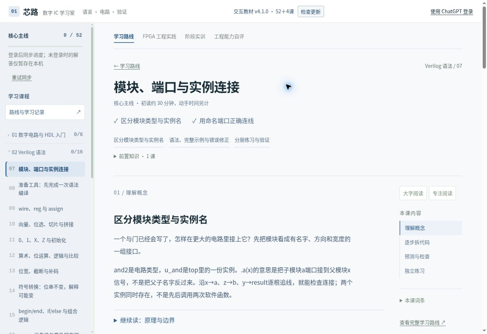
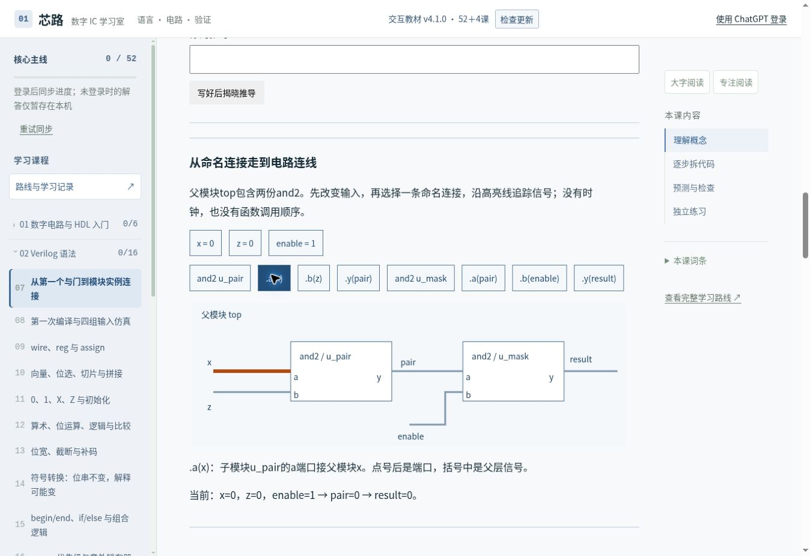

# 零基础教学修复交付记录

本轮基线：本地2950746、GitHub main c953c97。分支feat/beginner-teaching-quality。未合并main、未发布Sites、未写生产D1。

## 课程审查与改动

[修改前56课矩阵](BEGINNER_QUALITY_MATRIX.md)重新读取实际内容，主要发现：第7课假设已会写与门；基础课提前给RTL；异步FIFO早于RAM/FIFO；套话注解混淆仿真时间；练习缺规格、复用课堂答案；固定字符串比较拒绝等价接线。

[完整路线](COURSE_ROUTE.md)、[概念依赖图](COURSE_DEPENDENCIES.json)、[逐课五项审查](COURSE_SEMANTIC_REVIEW.json)、[十个第一次推演](BEGINNER_WALKTHROUGH.md)分别记录排序、概念边、目标/前置/示范/题目/独立条件及源码位置。“已通过”仅指编辑静态语义复核，不是实际学生学习效果验收。

前6课只要求数值、真值表和电路关系；第7课按单个AND→OR/XOR→类型/实例→单实例→内部wire→双实例连续教学；第8课引入完整四组输入自检；第9课才系统比较wire/reg和组合过程，第10课向量。异步FIFO移至同步FIFO后。casez、宏、多周期可后读，其他复杂语法标明进阶。

全56课改为202条具体关键行解释，删除无新增意义的结构行套话。FPGA补82条，覆盖19份RTL和4份TB。主线与FPGA注解均保存源码签名，回归会拒绝行号漂移；只有有注解的关键行可以点击。

原44道通用填空中43道重写功能和条件；四态课的提前if/$fatal题换为四态计算。32道Bug题全部换成不同迁移情境，例如双输出路径、模6终值、低有效锁存、结构字段顺序和队列方向。增加定位原因输入。保留255个活动位置，修改语义的题升revision3，旧答案进入历史。每题有目标ID和反向映射、提示及知识回链。

命名端口识别允许重排、拒绝重复端口；其他不认识的代码显示“尚不能自动判定”。识别器不是编译器。未知代码可记自查，但不算自动通过。错误先反馈当前作答和思考提示，不直接揭露完整答案。

## 交互和工程

新增实例接线高亮、位宽/符号/截断交互、Ready/Valid等待与违规反馈；FSM图与逐拍state/next联动；六课提供先预测后揭晓。保留Setup/Hold、偏斜和CDC固定模型，明确没有模拟亚稳态或真实STA能力。

编辑区保留缩进，Tab插两空格，Enter保持缩进，Shift+Tab可移出，显示当前行/总行数和保存反馈。未引入大型编辑器。

[项目A](../public/fpga/led-workflow/README.md)包含计数/使能LED的core、板级顶层、H=1/3自检TB、九环节说明、H=5独立暂停任务及自包含下载包。复位异步置入同步释放，极性在顶层适配，不猜引脚。[项目B](../public/fpga/workflow/README.md)保留UART完整工程。27个历史ID保留；20必修/7选修分开，必修下一步跳过独立专题。自测帮助定位前置，不强锁课程。三家适配继续明确版本与未验证边界。

## 历史记录

保留schema1、localStorage键、课程ID、合法完成、草稿、CAS同步与competition透明备份。新版活动保留history；旧客户端低revision不能覆盖新题作答，原写入存legacyClientAnswer并进入历史。旧FPGA客户端缺projects时Worker保留LED草稿；空白访客项目不参与覆盖云端项目。导入未完成数据不覆盖本机合法完成。未改D1表或迁移。

页面分别显示阅读、基础理解、练习自查、封闭题自动检查、真实仿真、板级验证。后两项没有运行器支持，保持未验证；旧完成标为自评，不升级成新验证证据。

## 实测

128组：8类页面×320/390/768/820/1024/1180/1280/1440px×默认/大字。无整页横向溢出，技术容器内部滚动。[原始测量](review/typography-measurements.json)。

|内容|默认|大字|
|---|---:|---:|
|正文/关键解释|17px|20px|
|代码/编辑|14px|17px|
|练习|16–17px|19–20px|
|图注/辅助|14px|16px|
|表格|16px|18px|

手机遮罩改为只占目录外侧，打开时正文inert，关闭/Escape恢复，跨横竖屏断点会关闭目录。390px复测关闭后课程不变，连接按钮可操作。平板为Chrome视口，不冒称真实iPad Safari/虚拟键盘测试。

|基线真实页面|修改后真实页面|
|---|---|
|||

[390px窄屏截图](review/module-mobile.jpg)保留QA上下文，不是静态设计稿。

## 验证与限制

|检查|结果|
|---|---|
|npm test|44项通过，含同步兼容、活动迁移、未知判定、目标映射、注解签名和模型|
|npm run lint / build|通过；资源指纹保留，QA不进入生产包|
|主线HDL展开|43个完整单元通过；13个规格/命令片段不计已编译|
|修复参考/新TB|32份带明确作用域参考+AND TB+LED TB，共34项展开通过|
|第7课精确源码|8种输入通过；错接第二实例在110被拒绝|
|基础周期检查|560次比较通过，故意+2计数器被拒绝|
|工程周期检查|95997次比较通过，覆盖RAM、FIFO、UART256字节、背压；错误FIFO及位序被拒绝|
|UART集成|520次检查通过，含非法字节、坏停止位和复位|
|LED项目A|800次比较通过，H=1/3、暂停/恢复、释放链、极性；终值差一变体被拒绝|
|通用综合|synth -noabc、check -assert及stat完成；162通用单元，其中28个FF位，非器件LUT/时序。[实际日志](review/led-generic-synthesis.log)|
|浏览器路由|56语言课、27 FPGA课标题逐一对应；另打开项目A|
|浏览器交互|填空、重排端口、未知反馈、刷新、LED导出导入、Tab/Enter、抽屉、NBA、FSM、背压反馈|

Yowasp默认ABC日志没有抵达最终stat，未计成功；改用-noabc并检查最终日志。CXXRTL是周期级执行，非事件仿真器。本环境无Icarus，TB只展开，未声称vvp运行。未执行商业工具、器件实现、实际STA、下载或板测。

仍待实现/验证：安全隔离的任意RTL事件仿真服务、更广的等价答案、真实零基础学生试学、真实iPad Safari和键盘、指定器件的三家流程与板卡验收。静态编辑审查与自动测试不能证明最终教学目标完全达成。

交付预览可在开发浏览器操作，或用node tools/package-review.mjs生成独立HTML（访客本地记录，无登录/云同步）。本轮不发布正式站。
